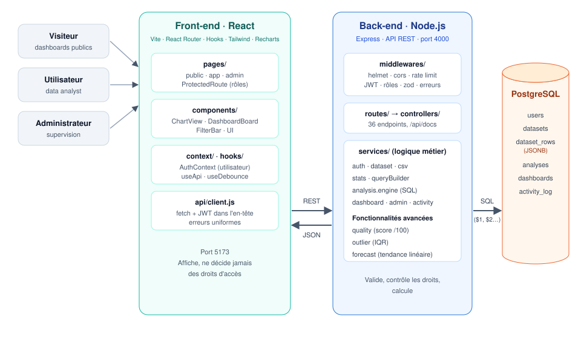
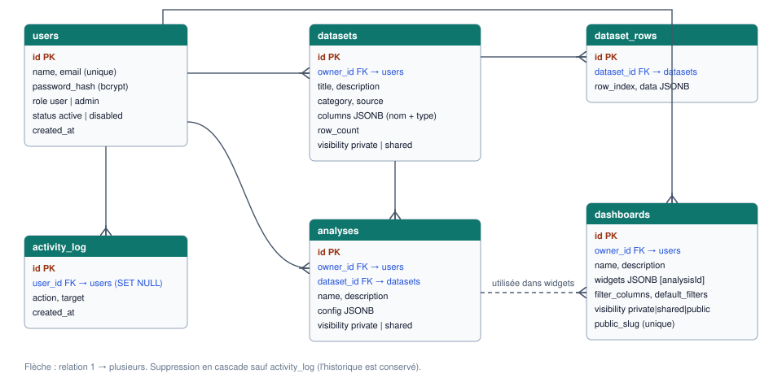

# EnergyInsight — Documentation de l'architecture

*Plateforme collaborative d'analyse et de visualisation de données énergétiques*  
*Projet Full Stack — React.js / Node.js / PostgreSQL*

---

## 1. Besoin traité

Les analyses énergétiques sont souvent faites à partir de fichiers CSV dispersés. EnergyInsight centralise ces données et couvre tout leur cycle de vie :

**Importation → Exploration → Analyse → Visualisation → Partage**

**Domaine choisi : la transition énergétique dans le monde.** Les données de démonstration viennent de *Our World in Data* (licence CC BY 4.0) :

| Jeu de données | Contenu | Taille |
|---|---|---|
| *Energy transition by country (1990–2025)* | consommation d'énergie primaire, énergie par habitant, parts fossile / renouvelable / solaire / éolien / hydraulique / nucléaire, intensité carbone, émissions | 7 603 lignes · 15 colonnes · 218 pays |
| *Electricity generation mix by country (2000–2025)* | production d'électricité par source (TWh), part renouvelable et fossile | 5 387 lignes · 13 colonnes |

Ces deux fichiers sont produits par un script reproductible, `database/prepare_data.py` (pandas) : lecture de la source brute (environ 23 000 lignes × 130 colonnes), suppression des agrégats (*World*, continents…), sélection des colonnes et des années, mise en forme. Aucune valeur n'est créée ni modifiée.

**Indicateurs métier mis en avant :**
- part des renouvelables
- consommation par habitant
- classement des plus gros consommateurs
- mix électrique
- intensité carbone
- tendance à 2030

## 2. Vue d'ensemble



Architecture **trois tiers** avec une séparation stricte entre front-end et back-end :

| Couche | Technologie | Rôle |
|---|---|---|
| Front-end | React 18, Vite, React Router 6, Hooks, Tailwind CSS, Recharts | Affichage, navigation, formulaires, graphiques |
| Back-end | Node.js 20+, Express 4, API REST | Authentification, droits d'accès, validation, calculs |
| Base de données | PostgreSQL 14+ (requêtes SQL paramétrées avec `pg`) | Stockage des utilisateurs, jeux de données, analyses, dashboards, journal d'activité |

**Principe directeur :** le front-end ne fait qu'afficher. Toute décision (droits d'accès, calculs, validation) est prise par l'API. Une règle contournée côté navigateur reste donc appliquée côté serveur.

## 3. Back-end

### 3.1 Organisation en couches

```
backend/src/
├── routes/        URL → middlewares → contrôleur
├── controllers/   lit la requête HTTP, appelle un service, renvoie la réponse
├── services/      logique métier et requêtes SQL
├── middlewares/   authentification, rôles, validation, upload, erreurs
├── validators/    schémas zod de toutes les entrées
├── docs/          description des endpoints → Swagger et Postman
└── config/        variables d'environnement, connexion PostgreSQL
```

Chaque couche a une responsabilité unique. On peut modifier la logique métier sans toucher aux routes, et inversement.

### 3.2 Cycle d'une requête

Exemple : `GET /api/datasets/1/rows?sortBy=year`

1. **helmet, cors** : en-têtes de sécurité, origine autorisée
2. **authenticate** : vérifie le JWT et recharge l'utilisateur depuis la base (un compte désactivé est bloqué immédiatement)
3. **validate (zod)** : vérifie les paramètres ; sinon erreur **400** détaillée champ par champ
4. **contrôleur → service** : contrôle des droits d'accès (sinon **403**), puis requête SQL
5. **errorHandler** : toute erreur est renvoyée au même format :
   `{ "error": { "message": "...", "details": [...] } }`

### 3.3 API REST

36 endpoints, regroupés par ressource :

| Préfixe | Accès | Contenu |
|---|---|---|
| `/api/auth` | public / utilisateur | inscription, connexion, profil, mot de passe |
| `/api/datasets` | utilisateur | CRUD, import CSV, lignes (recherche, filtres, tri, pagination), statistiques, score qualité, valeurs aberrantes |
| `/api/analyses` | utilisateur | aperçu sans sauvegarde (`/run`), CRUD, visibilité |
| `/api/dashboards` | utilisateur | CRUD, widgets, calcul avec filtres (`/:id/data`) |
| `/api/public` | visiteur | dashboards publics par lien |
| `/api/admin` | administrateur | indicateurs globaux, utilisateurs, jeux de données, journal |

**Documentation :**
- **Swagger** (interactive) : `http://localhost:4000/api/docs`
- **Postman** : `docs/EnergyInsight.postman_collection.json`, avec enregistrement automatique du jeton après connexion
- **OpenAPI 3** : `docs/openapi.json`

Les trois sont générées à partir d'une description unique (`backend/src/docs/endpoints.js`), elles ne peuvent donc pas se contredire.

## 4. Base de données



| Table | Contenu | Points clés |
|---|---|---|
| `users` | comptes | `role` user / admin, `status` active / disabled, mot de passe haché (bcrypt) |
| `datasets` | métadonnées d'un fichier importé | `columns` (JSONB) : nom et type détecté de chaque colonne |
| `dataset_rows` | une ligne du CSV = un objet JSONB | index `(dataset_id, row_index)` |
| `analyses` | configuration enregistrée (indicateurs, regroupement, filtres, graphique, prévision) | `config` JSONB, visibilité private / shared |
| `dashboards` | liste ordonnée d'analyses + filtres proposés | visibilité private / shared / public, `public_slug` |
| `activity_log` | journal des actions | alimente le tableau de bord d'administration |

Suppressions : `ON DELETE CASCADE` (un jeu de données supprimé emporte ses lignes et ses analyses), sauf pour le journal (`SET NULL`) afin de garder l'historique.

### Choix clé : stockage des lignes en JSONB

Chaque CSV a des colonnes différentes. Plutôt que de créer une table par fichier (DDL dynamique, complexe et risqué), chaque ligne est stockée comme un objet JSON :

```json
{ "country": "Morocco", "year": 2024, "renewables_share_energy": 8.67 }
```

- **Avantages :**
  - schéma fixe, n'importe quel CSV est accepté
  - PostgreSQL sait filtrer, trier et agréger dans le JSON (`(data->>'year')::numeric`)
- **Limite assumée :** au-delà de plusieurs millions de lignes, une table dédiée ou un entrepôt colonnaire serait plus rapide. Pour un MVP de quelques dizaines de milliers de lignes, les temps de réponse restent de quelques millisecondes.

## 5. Traitements de données

### 5.1 Import et détection des types (`csv.service.js`)
- **Lecture :** papaparse détecte automatiquement le séparateur (virgule, point-virgule ou tabulation).
- **Type de chaque colonne :**
  - *nombre* : accepte aussi la virgule décimale française, ex. `120,5`
  - *date* : `2024-05-01`, `2024-05` ou `01/05/2024`
  - *texte* : tout le reste
- **Valeurs manquantes :** les cellules vides et `NA`, `N/A`, `null` deviennent des valeurs manquantes.
- **Insertion :** par lots de 2 000 lignes, dans une transaction (tout ou rien).

### 5.2 Moteur d'analyse (`analysis.engine.js`)
Une analyse est une **configuration**, pas une copie de données. Elle comprend :
- **indicateurs :** 1 à 4, parmi somme, moyenne, min, max, comptage
- **regroupement :** par pays, par année…
- **filtres**
- **tri et limite** (classements)
- **type de graphique :** barres, courbes, secteurs, cartes KPI ou tableau

Elle est traduite en **une seule requête SQL** exécutée par PostgreSQL. Seul le résultat agrégé, quelques dizaines de lignes, est envoyé au navigateur.

### 5.3 Dashboards
Un dashboard combine plusieurs analyses et propose des filtres (ex. *pays*, *année*). Choisir une valeur recalcule tous les widgets.

**Règle :** un filtre du dashboard **remplace** le filtre de l'analyse sur la même colonne. La même analyse « Maroc » fonctionne ainsi pour n'importe quel pays.

### 5.4 Fonctionnalités avancées (trois, toutes issues de la liste du sujet)

| Fonctionnalité | Méthode | Où |
|---|---|---|
| **Score de qualité des données** | complétude (50 pts) + unicité (25 pts) + cohérence (25 pts) → note A à D et recommandations | Explorateur → *Data quality* |
| **Détection des valeurs aberrantes** | méthode de l'écart interquartile (IQR) : hors de [Q1 − 1,5·IQR ; Q3 + 1,5·IQR] | Explorateur → *Outliers* |
| **Prévision simple** | régression linéaire (moindres carrés) prolongée depuis la dernière valeur connue, pente par an et R² | Analyse → *Forecast*, visible dans les dashboards |

## 6. Front-end

- **React Router :** trois zones (visiteur, utilisateur, administrateur). Le composant `ProtectedRoute` redirige selon la connexion et le rôle.
- **Hooks :**
  - `AuthContext` (`useAuth`) partage l'utilisateur connecté
  - `useApi` gère chargement et erreurs
  - `useDebounce` évite un appel à l'API à chaque frappe
- **Couche API (`src/api/`) :** une fonction par endpoint. Le client ajoute le jeton JWT et transforme les erreurs de l'API en messages affichés sous les champs des formulaires.
- **Composants réutilisés :**
  - `ChartView` dessine tous les graphiques (analyses, dashboards, administration)
  - `DashboardBoard` sert à la fois pour la page interne et la page publique
- **Graphiques :** palette de couleurs fixe et vérifiée pour les daltoniens ; barres horizontales pour les classements de pays.

## 7. Sécurité

| Exigence du sujet | Mise en œuvre |
|---|---|
| Protection des mots de passe | hachage **bcrypt** ; même message d'erreur si l'email ou le mot de passe est faux ; **10 tentatives / 15 min** par IP |
| Protection des routes | **JWT** (1 jour) vérifié à chaque requête ; l'utilisateur est rechargé depuis la base (compte désactivé bloqué immédiatement) |
| Droits d'accès | middleware `requireRole('admin')` ; contrôle propriétaire / admin / partagé dans chaque service ; double protection côté front (`ProtectedRoute`) |
| Validation des données | schéma **zod** pour chaque entrée ; fichiers limités au `.csv` et à 10 Mo |
| Gestion des erreurs | middleware central, format unique, aucun détail technique renvoyé en cas d'erreur 500 |
| Injection SQL | toutes les valeurs **et** noms de colonnes passent en paramètres (`$1`, `$2`…) ; noms de colonnes vérifiés contre la liste connue |
| Divers | en-têtes **helmet**, **CORS** limité à l'application, liens publics aléatoires (48 bits) |

**Règles de partage :**

| Visibilité | Propriétaire / admin | Autres utilisateurs | Visiteurs |
|---|---|---|---|
| Privé | lecture + modification | — | — |
| Partagé | lecture + modification | lecture (et copie) | — |
| Public (dashboards) | lecture + modification | lecture | lecture via le lien |

Sur un lien public, seuls les widgets appartenant au propriétaire du dashboard sont affichés : on ne peut pas publier le travail d'un autre utilisateur.

## 8. Difficultés rencontrées et choix faits

| Difficulté | Solution retenue |
|---|---|
| Accepter n'importe quel CSV sans créer de tables à la volée | stockage JSONB + liste des colonnes typées |
| Éviter l'injection SQL avec des colonnes choisies par l'utilisateur | noms de colonnes en paramètres et vérifiés |
| Ne pas envoyer des milliers de lignes au navigateur | filtres, tri, pagination et agrégations exécutés en SQL |
| Réutiliser une analyse pour plusieurs pays | filtres de dashboard qui remplacent ceux de l'analyse |
| Prévision qui « saute » entre la dernière valeur réelle et la droite ajustée | tendance prolongée à partir de la dernière valeur connue |
| Dashboards publics sans fuite de données | widgets limités aux analyses du propriétaire, lien aléatoire supprimé quand le dashboard n'est plus public |

## 9. Améliorations envisageables

- **Jeton :** stocké en cookie *httpOnly* plutôt qu'en `localStorage` (protection contre le XSS)
- **Import :** Excel/JSON et connexion directe à l'API Our World in Data
- **Carte choroplèthe :** analyse géographique (le code ISO des pays est déjà présent)
- **Prévision :** modèles plus réalistes (ARIMA, Prophet) que la tendance linéaire
- **Tableaux de bord :** glisser-déposer ; partage avec des utilisateurs précis plutôt qu'avec tous
- **Qualité logicielle :** tests automatisés (Jest + Supertest) et intégration continue
- **Déploiement :** Docker Compose, puis hébergement cloud

## 10. Livrables et lancement

| Livrable | Emplacement |
|---|---|
| Code source | `backend/`, `frontend/` |
| Scripts de base de données | `database/schema.sql`, `backend/scripts/setup-db.js` (données de démonstration) |
| Documentation de l'architecture | `docs/ARCHITECTURE.md` (ce document) |
| Documentation de l'API | Swagger `/api/docs`, `docs/openapi.json`, collection Postman |

**Lancement :** voir `README.md`, en trois étapes :
1. créer la base
2. `npm run db:setup`
3. `npm run dev` dans `backend/` et dans `frontend/`
